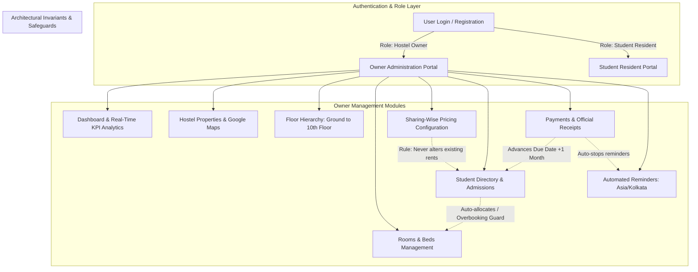

# 🏢 Narasimha PG Hostel Manager v3.0

> **Enterprise PG Hostel & Bed Management SaaS Platform for Hyderabad, Telangana, India**


---

## 📌 Overview

**Narasimha PG Hostel Manager** is a complete, commercial-grade, multi-property PG hostel management software engineered for paying guest (PG) owners and student residents in Hyderabad, Telangana, India.

It manages the entire lifecycle of multi-property hostel operations:
- Multiple hostel properties with complete locality addresses, contact info, and Google Maps integration.
- Separate floor management from Ground Floor to 10th Floor + custom floors.
- Granular bed slot tracking with overbooking and duplicate booking prevention.
- Sharing-wise pricing (1 to 5 sharing) with **permanent agreed rent protection** for existing students.
- Full student check-in, bed assignment, emergency contact tracking, and 1-click checkout.
- Automated daily rent expiry reminders in **Asia/Kolkata** timezone (1 day before & on due date).
- Payment recording (UPI, Cash, Bank Transfer), partial payment tracking, next due date advancement, and official printable receipt generation (`RCP-2026-XXX`).
- Executive owner analytics dashboard and a dedicated Student Resident Portal.

---

## 🏗️ Architecture



---

## 🚀 Key Modules & Features

### 1. Hostel Property Management
- Manage multiple hostels under one account (e.g. *Sai PG* in Madhapur, *Lakshmi PG* in Hitec City, *Sri Sai Boys Hostel* in Ameerpet).
- Full address info: Area, City, State, PIN code, contact number, and total floors.
- **Clickable Google Maps link**: opens exact hostel address in Google Maps.
- Safe delete protection: blocks deletion if active residents reside.

### 2. Floor & Room Management
- 11 Standard Floors (Ground Floor through 10th Floor) + custom floors (e.g. Penthouse).
- Exact room card format:
  ```text
  Room Number: 205
  Floor: 2nd Floor
  Sharing: 3 Sharing
  Monthly Rent: ₹6,000 per person
  Washroom: Attached
  AC: Non-AC
  Occupied Beds: 2
  Available Beds: 1
  ```
- Washroom facilities: Attached Washroom (Yes/No), Common Washroom (Yes/No).
- Visual bed slot indicators with occupant names.

### 3. Sharing-Wise Pricing
- Pricing configuration per sharing tier:
  - Single Sharing: ₹10,000 / month
  - 2 Sharing: ₹7,000 / person / month
  - 3 Sharing: ₹6,000 / person / month
  - 4 Sharing: ₹5,000 / person / month
  - 5 Sharing: ₹4,500 / person / month
- **Agreed Rent Invariant**: Updating room prices **never** mutates existing students' agreed monthly rent.

### 4. Student Management & Check-in
- Student ID codes: `STU-2026-XXX`.
- Contact information, admission dates, agreed rent, and emergency contacts.
- Strict overbooking guard: prevents duplicate bed allocations.
- Vacating student instantly releases their bed slot back to "Available".

### 5. Automated Rent Expiry Reminders
- Daily background scheduler in `Asia/Kolkata` timezone (09:00 AM IST).
- Two automatic notices:
  1. **1 Day Before Due Date (24-hour notice)**
  2. **On Expiry / Due Date (Due day notice)**
- Duplicate prevention: logs ensure no repeated reminders on the same day.
- Auto-stops reminders once payment is recorded.
- Manual 1-click WhatsApp web direct link (`https://wa.me/...`).

### 6. Payments & Official Receipts
- Track Expected Revenue, Collected Revenue, and Pending Revenue.
- Full and partial payment recording via UPI, Cash, Bank Transfer, or Card.
- Auto-advances student's next payment due date by +1 month upon full payment.
- Official printable payment receipts (`RCP-2026-XXX`) with print-optimized CSS.
- 1-click CSV payment data export.

### 7. Executive Dashboard & Student Portal
- Real-time KPI summary cards and 4 interactive SVG charts.
- Dedicated Student Resident Portal with personal room, bed, rent, and payment receipt history.

---

## 🛠️ Project Structure

```text
├── index.html                   # Application HTML entry point
├── server.js                    # Node.js HTTP server & Asia/Kolkata reminder scheduler
├── package.json                 # Project dependencies and test scripts
├── .env.example                 # Safe environment variables template
├── .gitignore                   # Git exclusion rules
├── css/
│   └── style.css                # Professional SaaS blue-and-white theme & print rules
├── js/
│   ├── db.js                    # Core enterprise DatabaseService & business logic
│   └── app.js                   # Application UI Controller, views, and modal handlers
├── supabase/
│   └── migrations/
│       ├── 001_initial_schema.sql       # Baseline schema
│       ├── 002_add_hostel_details.sql   # Extended location fields
│       └── 003_full_saas_schema.sql     # Full 10-table PostgreSQL SaaS schema
├── tests/
│   ├── test_hostel_manager.js   # Unit & regression tests (8/8 passing)
│   └── test_saas_full.js        # Comprehensive SaaS acceptance suite (16/16 passing)
└── website/                     # Synchronized static production bundle
```

---

## ⚙️ Installation & Local Setup

### Prerequisites
- [Node.js](https://nodejs.org/) v18+ (tested on Node.js v24)
- A modern web browser (Chrome, Edge, Firefox, Safari)

### Quick Start
1. Clone the repository:
   ```bash
   git clone https://github.com/<your-username>/narasimha-pg-hostel-manager.git
   cd narasimha-pg-hostel-manager
   ```

2. Copy the environment configuration template:
   ```bash
   cp .env.example .env
   ```

3. Start the application:
   ```bash
   npm start
   ```

4. Open your browser and navigate to:
   ```text
   http://localhost:3000
   ```

### Demo Accounts
- **Hostel Owner**: `owner1@hostel.com` / `password123` (*Narasimha Rao*)
- **Student 1 (Due Tomorrow)**: `ravi@gmail.com` / `student123` (*Ravi Kumar*)
- **Student 2 (Due Today)**: `suresh@gmail.com` / `student123` (*Suresh Varma*)

*(Or use the 1-click Quick Login buttons on the sign-in screen)*

---

## 🧪 Testing

Run the full automated test suite verifying all 16 major SaaS modules:

```bash
npm test
```

### Test Results
```text
================================================================
ALL 16 SAAS ACCEPTANCE TESTS COMPLETED SUCCESSFULLY! (16/16)
================================================================
[PASS] Test 1/16: Multi-Role Authentication & Access Isolation
[PASS] Test 2/16: Hostel Management CRUD, Addresses & Google Maps Links
[PASS] Test 3/16: Delete Hostel Safety Confirmation (Blocks deletion when active students reside)
[PASS] Test 4/16: Floor Management: 11 Standard Floors & Custom Floors
[PASS] Test 5/16: Sharing-Wise Pricing Configuration per Hostel
[PASS] Test 6/16: CRITICAL INVARIANT: Updating Room Prices Does NOT Alter Existing Students Agreed Rent
[PASS] Test 7/16: Room Details & Exact Formatting (Room 205 in Sri Sai Boys Hostel)
[PASS] Test 8/16: Room Capacity Validation & Bed Reduction Safety Guard
[PASS] Test 9/16: Student Admission, Bed Assignment & Duplicate Bed Prevention
[PASS] Test 10/16: Student Vacating Automatically Releases Bed Slot
[PASS] Test 11/16: Automated Rent Expiry Reminders in Asia/Kolkata Timezone
[PASS] Test 12/16: Duplicate Reminder Prevention (No repeat notifications on same day)
[PASS] Test 13/16: Payment Recording Advances Due Date by +1 Month and Stops Reminders
[PASS] Test 14/16: Partial Payment Tracking & Remaining Pending Balance
[PASS] Test 15/16: Executive Dashboard KPI Calculations & Real-time Aggregation
[PASS] Test 16/16: Database State Persistence Across Browser Refresh / Re-instantiation
```

---

## 🔒 Security & Privacy

- No API keys, secret credentials, or database passwords are hardcoded in source code.
- `.gitignore` strictly ignores local databases, environment secrets, and temporary files.
- Role-based security guarantees that hostel owners cannot access other owners' data, and student residents can only inspect their personal room and payment records.

---

## 📄 License

This project is licensed under the [MIT License](LICENSE).
